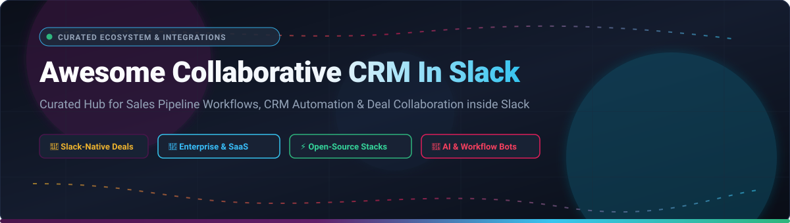

  

  
  
  
  
  
  

# 🚀 Awesome Collaborative CRM In Slack

> 🌟 **A curated list of SaaS platforms, open-source CRM software, Slack bots, and workflow integrations designed for seamless sales pipeline management, deal collaboration, and RevOps directly within Slack.**

Managing customer relationships and sales pipelines shouldn't require constant context-switching between chat and heavyweight CRM interfaces. **Collaborative CRM in Slack** bridges this divide by turning Slack channels into interactive sales war rooms where deal updates, pipeline hygiene, customer inquiries, and revenue forecasting happen natively in real time.

---

## 📑 Table of Contents

- [📊 Sector Overview & Market Dynamics](#-sector-overview--market-dynamics)
- [🏢 SaaS & Hosted Platforms](#-saas--hosted-platforms)
- [⚡ Open-Source CRM & Integration Projects](#-open-source-crm--integration-projects)
- [🛠️ Frameworks for Building Custom Slack CRM Bots](#️-frameworks-for-building-custom-slack-crm-bots)
- [🤝 How to Contribute](#-how-to-contribute)
- [💖 Support](#-support)
- [📈 Star History](#-star-history)
- [📜 Disclaimer](#-disclaimer)

---

## 📊 Sector Overview & Market Dynamics

The global CRM software market is valued at approximately **$79 billion in 2024 and projected to surpass $157 billion by 2030** (CAGR ~12%), with conversational and collaborative CRM representing the fastest-growing operational layer within RevOps; the overall sector is **moderately fragmented**—anchored by dominant enterprise platforms like Salesforce and HubSpot, but surrounded by high fragmentation among specialized deal collaboration assistants, Slack-native workflow bots, and self-hosted open-source challengers.

---

## 🏢 SaaS & Hosted Platforms

| Product | Company Size (Valuation / Revenue) | Pricing | Free Tier / Trial Limits | Description |
| :--- | :--- | :--- | :--- | :--- |
| **[Salesforce Sales Cloud in Slack](https://www.salesforce.com/slack/)** | ~$300B Market Cap (~$38B Annual Revenue) | From $25/user/month (Starter Suite) | 30-day free trial; full access to Starter Suite features with sample sales data, no credit card required | Native Slack app bringing CRM data, opportunity pipeline alerts, and Slack Sales Elevate workflows directly into channels. |
| **[HubSpot Slack Integration](https://www.hubspot.com/)** | ~$35B Market Cap (~$2.6B Annual Revenue) | From $15/seat/month (Starter CRM Suite) | Free forever plan with up to 5 users, 1M contacts, deal tracking, and basic Slack notifications | Bidirectional Slack integration providing real-time deal alerts, slash command record lookup, and conversation-to-lead capture. |
| **[Atlassian Halp / Jira Service Management](https://www.atlassian.com/software/halp)** | ~$45B Market Cap (~$4.9B Annual Revenue) | From $22.05/agent/month (Standard) | Free forever plan for up to 3 agents, 2 GB file storage, unlimited customers, and native Slack conversational ticketing | Conversational support and internal helpdesk ticketing native to Slack; converts channel emoji reactions into actionable CRM/service tickets. |
| **[Asana for Slack](https://asana.com/)** | ~$3B Market Cap (~$700M Annual Revenue) | From $10.99/user/month (Personal / Starter) | Free forever plan for up to 10 users with unlimited tasks, projects, messages, and basic Slack task creation | Turns Slack messages into actionable CRM follow-up tasks, project milestones, and deal approvals without context-switching. |
| **[Zoho CRM for Slack](https://www.zoho.com/crm/)** | ~$1.4B Annual Revenue (Bootstrapped Private) | From $14/user/month (Standard, billed annually) | Free forever plan for up to 3 users with essentials (leads, documents, contacts) and 15-day free trial on enterprise tiers | Cost-effective CRM integration featuring Slack notification triggers, contact search, lead creation from messages, and deal stage updates. |
| **[Pipedrive for Slack](https://www.pipedrive.com/)** | ~$1.5B Valuation (Vista Equity Partners, ~$150M+ ARR) | From $14/user/month (Lite / Essential, billed annually) | 14-day free trial with full access to all features, pipeline views, and Slack deal bot alerts; no credit card required | Sales-focused pipeline CRM offering Slack deal bot notifications, automatic deal creation, and shared sales win celebrations. |
| **[Workbot for Slack (Workato)](https://www.workato.com/)** | $5.7B Valuation (~$150M+ ARR) | From $10,000/year (Base workspace + recipe packs) | 14-day free trial with access to automation recipes, Slack bot actions, and community connector libraries | Enterprise workflow bot orchestrating bidirectional data flows between Slack and 400+ cloud platforms including Salesforce, HubSpot, and ERPs. |
| **[Wrike for Slack](https://www.wrike.com/)** | ~$2.25B Valuation (Symphony Technology Group) | From $9.80/user/month (Team tier) | Free forever plan with unlimited users, 2 GB storage, basic task management, and 14-day trial on advanced plans | Project management and client work-tracking app allowing teams to turn conversations into tasks, view previews, and track work from Slack. |
| **[Troops.ai / Slack Sales Elevate](https://www.salesforce.com/slack/)** | Acquired by Salesforce for ~$100M+ | From $60/user/month (Add-on to Sales Cloud) | 30-day free trial through Salesforce Sales Cloud pilot programs | Acquired by Salesforce to form Slack Sales Elevate; delivers automated pipeline inspection, reminders, and mobile-friendly deal management. |
| **[Scratchpad](https://scratchpad.com/)** | ~$50M+ Valuation ($13M+ Series A funding) | From $29/user/month (Business tier) | Free forever plan for up to 100 updates/month, spreadsheet view, and Slack deal notifications | Workspace built specifically for revenue teams updating Salesforce from Slack and browser tabs with automated hygiene alerts. |
| **[Copper CRM](https://www.copper.com/)** | ~$50M+ Valuation ($100M+ VC funding) | From $12/user/month (Starter tier, billed annually) | 14-day free trial with full access to Google Workspace sync, pipeline tools, and Slack alert integrations | Google Workspace and Gmail-first CRM with Slack integration for instant deal alerts, contact activity logs, and pipeline monitoring. |

---

## ⚡ Open-Source CRM & Integration Projects

Curated open-source CRM systems, automated workflow hubs, and Slack bots that provide transparent, self-hosted, and extensible alternatives to proprietary platforms. Repositories are ranked by GitHub Stars_Count:

- **[n8n](https://github.com/n8n-io/n8n)**  — Fair-code workflow automation platform with comprehensive Slack and CRM nodes for custom deal pipelines, data synchronization, and interactive alert triggers.
- **[NocoDB](https://github.com/nocodb/nocodb)**  — Open-source Airtable alternative transforming any relational database (PostgreSQL, MySQL, SQLite) into an intelligent collaborative CRM with webhook triggers and Slack notifications.
- **[Twenty](https://github.com/twentyhq/twenty)**  — Modern, full-featured open-source CRM (GPL-3.0) built as an extensible alternative to Salesforce and HubSpot. Features customizable relational data models, Kanban views, workflow automation, and native Slack integrations.
- **[Chatwoot](https://github.com/chatwoot/chatwoot)**  — Open-source customer engagement suite and CRM inbox that seamlessly connects live chat, email, and social channels with bidirectional Slack notifications and agent handoffs.
- **[Activepieces](https://github.com/activepieces/activepieces)**  — Open-source Zapier alternative (MIT license) featuring prebuilt community pieces for Slack bots, Salesforce, HubSpot, and custom CRM webhooks.
- **[Krayin CRM](https://github.com/krayin/laravel-crm)**  — Free and open-source Laravel-based CRM for enterprise workflow management, lead tracking, and extensible REST APIs for building interactive Slack apps.
- **[Mautic](https://github.com/mautic/mautic)**  — Open-source marketing automation and lead management platform with deep campaign tracking, webhooks, and Slack channel alert integrations.
- **[Baserow](https://github.com/baserow/baserow)**  — Open-source no-code database platform (MIT license) ideal as a lightweight collaborative CRM backend with rich APIs and webhooks for Slack bots.
- **[SuiteCRM](https://github.com/salesagility/SuiteCRM)**  — Mature enterprise-grade open-source CRM (AGPL-3.0) with granular role management, sales automation, and webhook connectors for Slack workspaces.
- **[erxes](https://github.com/erxes/erxes)**  — Open-source developer-friendly experience operating system (XOS) combining CRM, sales pipeline, team messaging, and Slack integrations.
- **[Frappe CRM](https://github.com/frappe/crm)**  — Modern, open-source CRM built on the Frappe framework with lead tracking, deal pipelines, customer interactions, and webhook automation for Slack.
- **[EspoCRM](https://github.com/espocrm/espocrm)**  — Lightweight, fast open-source web application designed for relationship and sales tracking with a complete REST API and Slack integration tools.
- **[Horilla CRM](https://github.com/horilla-opensource/horilla)**  — Free, self-hosted CRM built on Django (LGPL-2.1) with deal pipelines, lead capture, sales forecasting, Docker deployments, and native Slack alerts.
- **[Slack Bolt for JavaScript](https://github.com/slackapi/bolt-js)**  — Official framework for building modern Slack interactive apps, modals, and bidirectional CRM bots with Node.js and TypeScript.
- **[Slack Bolt for Python](https://github.com/slackapi/bolt-python)**  — Official Python framework for creating custom conversational bots, slash commands, and CRM ingestion pipelines inside Slack.
- **[CustomerMates](https://github.com/customermates/customermates)**  — Self-hostable open-source CRM (AGPL-3.0) for small B2B teams featuring contact management, pipelines, and native n8n nodes for Slack updates.
- **[ChatterMate](https://github.com/chattermate/chattermate.chat)**  — Open-source AI customer support and lead qualification agent with Slack bot integration, human-in-the-loop handoff, and CRM sync workers.
- **[OpenCRM](https://github.com/clawnify/OpenCRM)**  — Lightweight open-source HubSpot alternative for SaaS teams managing companies, contacts, deals, and webhook alerts for Slack.
- **[Quix by ClearFeed](https://github.com/clearfeed/quix)**  — AI-powered Slack bot that connects internal workspace channels to CRM and issue-tracking platforms (HubSpot, Jira, GitHub) via natural language.

---

## 🛠️ Frameworks for Building Custom Slack CRM Bots

To construct a bespoke, privacy-first collaborative CRM inside your organization:

1. **CRM Backend**: Deploy **[Twenty](https://github.com/twentyhq/twenty)** or **[Horilla CRM](https://github.com/horilla-opensource/horilla)** for self-hosted contact and deal storage.
2. **Interactive UI Layer**: Utilize **[Slack Bolt for Python](https://github.com/slackapi/bolt-python)** or **[Slack Bolt for JavaScript](https://github.com/slackapi/bolt-js)** to render interactive Block Kit modals, buttons, and slash commands.
3. **Workflow Orchestration**: Connect events using **[n8n](https://github.com/n8n-io/n8n)** or **[Activepieces](https://github.com/activepieces/activepieces)** to push notifications when deal stages progress or new leads appear.
4. **Data Persistence**: Back your stack with **PostgreSQL** or **[NocoDB](https://github.com/nocodb/nocodb)** for scalable data ownership with zero licensing fees.

---

## 🤝 How to Contribute

Contributions are warmly welcomed! Help keep this curated directory up-to-date:

1. 🍴 Fork the repository.
2. 📝 Add or update an entry in [`README.md`](README.md) following the established table or badge structure.
3. 🔍 Ensure pricing, company metrics, and Stars_Counts are factually sourced.
4. 🚀 Submit a pull request with a brief summary of the changes.

---

## 💖 Support

If you found this list helpful, consider supporting this project!

- ⭐ **Star this repository** to help others discover it.
- 🍴 **Fork and share** it with your sales, RevOps, and developer teammates.
- ☕ **Sponsor**: Buy me a coffee via the [GitHub Sponsor Dashboard](https://github.com/sponsors/ishandutta2007).

---

## 📈 Star History

---

## 📜 Disclaimer

- This is a community-curated directory intended for informational purposes and does not represent an endorsement of any specific vendor.
- Handling CRM records, customer personally identifiable information (PII), and financial deals in Slack channels requires appropriate adherence to compliance frameworks (GDPR, SOC 2, CCPA).
- Self-hosted open-source software should be regularly audited, patched, and secured behind proper authentication layers.
